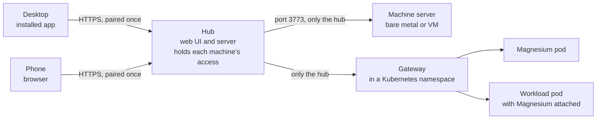

<!-- magnesium: Magnesium's own README. On a merge conflict, keep ours; scripts/merge-upstream.ts does. -->

# Magnesium

**A self-hosted web app for running and watching coding agents across your machines.** Install it as an app on your desktop, open it on your phone, and see every Claude Code, Codex and OpenCode thread on every machine through one hub: what is running, what is waiting on you, and what failed.

[](https://github.com/iammrduncan/magnesium/actions/workflows/magnesium-ci.yml)
[](LICENSE)

[Install](#install) · [Using the hub](docs/user/hub.md) · [Docs](docs/README.md) · [Goals](docs/magnesium/goals/README.md) · [Discord](https://discord.gg/3Qs2uejUf9)

Magnesium is a fork of [T3 Code](https://github.com/pingdotgg/t3code), built for one person who drives several agents all day. It keeps T3 Code's server on each machine and puts a hub in front of them: you pair each device with the hub once, and the hub carries every machine. Agents start supervised and run fenced, so they can't touch Magnesium's own files. There are no accounts and nothing hosted. The name comes from the magnesium ribbon that lights [thermite](https://github.com/iammrduncan/thermite); the mark is a plain **Mg**.



Every server, the hub included, runs the agents' CLIs as fenced subprocesses. On a single box, the hub is the only server.

## Status

Early. Magnesium is built in numbered [goals](docs/magnesium/goals/README.md), each ending in a test by hand on real machines. It is built on T3 Code v0.1.0. There are no releases yet.

| Works today                                                                                                  | Read                                                            |
| ------------------------------------------------------------------------------------------------------------ | --------------------------------------------------------------- |
| **The hub:** pair a device once, and it sees every machine, project and thread                               | [Sign in](docs/user/hub.md#sign-in-your-first-device)           |
| **Fleet:** every machine live, Connected or Offline, with its running and waiting threads                    | [Fleet](docs/user/hub.md#fleet)                                 |
| **Home:** approvals, questions, plans and failed runs from every machine, answered in place, with Undo       | [Home](docs/user/hub.md#home)                                   |
| **Scheduled tasks** (T3 Code's scheduler): failed runs on Home with Retry, and the next runs beside the feed | [Home](docs/user/hub.md#home)                                   |
| **The footer:** machines, offline machines and threads that need you, across all of them                     | [The footer](docs/user/hub.md#the-footer)                       |
| **The desktop app:** installs from Chrome, Edge or Safari, and shows Offline when the hub can't be reached   | [Install it as an app](docs/user/hub.md#install-it-as-an-app)   |
| **The phone,** in its browser, with the same machines and threads                                            | [Add a phone](docs/user/hub.md#add-a-phone-or-another-computer) |
| **Profiles and sandboxes:** agents with their own rules, skills and MCP servers, fenced or in a container    | [Profiles and sandboxes](docs/user/profiles-and-sandboxes.md)   |
| **Machines in Kubernetes,** in a pod of their own or attached inside a workload's pods                       | [Machines in Kubernetes](docs/user/kubernetes.md)               |

Scheduled tasks are the newest: Retry on Home has not yet been tried on a live failure.

**Planned:** installing on the phone, with push to a locked phone (goal 07); rooms where you and several bots talk (08, 09); load, GPUs and launching work in Fleet (10); projects across machines (15); the Brain, a knowledge base Magnesium runs (29, 12, 13); apps and footer items (16, 27, 28); provider sign-ins kept on the hub (30); adding a machine over SSH (31). The [goals](docs/magnesium/goals/README.md) hold the whole plan, and the [decisions](docs/magnesium/09-decisions-and-open-questions.md) the reasons.

**Harnesses:** Claude Code, Codex and OpenCode are the ones Magnesium uses and tests. OpenCode can run through any OpenAI-compatible gateway, for a machine with no Claude Code or Codex sign-in. T3 Code's other adapters (Cursor, Grok, Antigravity, Pi and others) ship unchanged and untested.

## Install

The Ansible roles in [`magnesium/deploy/ansible`](magnesium/deploy/ansible/README.md) install Magnesium on a single box, where the hub runs the agents itself, or on a hub with machines. You need:

- a Linux box with `git`, `xz-utils` and `ca-certificates`, and a user other than root to run Magnesium as (the role installs Node 24 for that user);
- Claude Code, Codex or OpenCode, installed and signed in as that user ([provider setup](docs/user/install.md#providers));
- Ansible 2.19 or later on a computer that reaches the box over SSH as that user.

```sh
git clone https://github.com/iammrduncan/magnesium.git
cd magnesium/magnesium/deploy/ansible
cp inventory.example.yml inventory.yml               # your box under magnesium_hub; remove the other hosts
cp group_vars/all.example.yml group_vars/all.yml     # the commit to run, and your time zone
cp group_vars/magnesium_hub.example.yml group_vars/magnesium_hub.yml   # its address and URL; empty the machine list
ansible-playbook magnesium.yml                       # or: uvx --from ansible-core ansible-playbook magnesium.yml
```

The playbook builds that commit on the box and runs it as a systemd user service. Then, on the box, in your own terminal (not through an agent):

```sh
~/.local/share/magnesium/bin/magnesium-release pair --admin
```

It prints a link, a code and a QR code. Open the link on your desktop within 15 minutes. That device is signed in, and can add your phone from **Settings → Connections → Authorized clients**.

- **Address and HTTPS:** in `group_vars/magnesium_hub.yml`, `magnesium_host: 127.0.0.1` needs a reverse proxy in front, with a certificate your devices trust, or `magnesium_hub_publish: true`, which publishes the hub as a Tailscale Service. A LAN address works in a browser over plain HTTP, but installing the app (and, later, push) needs HTTPS.
- **No one logged in:** set `magnesium_enable_linger: true` in `group_vars/all.yml` so the service keeps running (it needs sudo once).
- **More machines, rollback and backups** are in the [deploy runbook](magnesium/deploy/ansible/README.md), and machines in Kubernetes in [their guide](docs/user/kubernetes.md).

### Try it from source

To look around on your own computer, install Node 24 and [Vite+](https://viteplus.dev/guide/) (`vp`), sign in to a provider (`claude auth login`, `codex login` or `opencode auth login`), then:

```sh
vp i
vp run --filter t3 build
mkdir -p ~/.magnesium/userdata
cp magnesium/deploy/seed/settings.json ~/.magnesium/userdata/settings.json   # threads start supervised
T3CODE_HOME=~/.magnesium node apps/server/dist/bin.mjs serve --host <address>
```

It prints a pairing link that works for 5 minutes. To pair another browser later, run `node apps/server/dist/bin.mjs pair` with the same `T3CODE_HOME`. Keep Magnesium's state apart from any T3 Code install in `~/.t3`, and don't use `t3 service install`. To keep a server running, use the systemd user unit in [`magnesium/deploy`](magnesium/deploy/README.md): it runs a release that `magnesium-release build` and `activate` put in place, which is what the Ansible roles do.

## How it works

- **A server per machine.** Each machine runs T3 Code's server, which drives the provider CLIs as subprocesses. It keeps every thread as an event log in SQLite, and ends each turn with a checkpoint, a hidden git ref, so you can see the diff and restore it.
- **One front door.** The hub carries each machine under its own route, with an access grant only the hub holds. The grant lasts 30 days, and the hub renews it a week early. The hub opens every connection, and machines never call it. Your devices talk to the hub only, and each machine's port should [admit the hub alone](magnesium/deploy/ansible/README.md#only-the-hub-reaches-a-machine).
- **Pairing is the sign-in.** A one-time link or QR code signs a device in to the hub. A device with **Manage access** can add others and revoke them.
- **Supervised by default.** New threads ask before running commands or changing files. Full access is chosen per thread, never by default and never by a profile.
- **Fenced agents.** Every agent runs fenced by default: as you, in your projects, but unable to read or change Magnesium's state, its install or the hub's access. The fence uses bubblewrap, a Linux user namespace or Landlock on Linux, and Seatbelt on macOS. The container level runs an agent in rootless Podman, seeing only its project.
- **Profiles live on the hub,** as folders of rules, skills and MCP servers. The hub sends each to the machines it names, and refuses one that would weaken your control.

## Docs

| Read this                                                     | To                                                                   |
| ------------------------------------------------------------- | -------------------------------------------------------------------- |
| [The hub](docs/user/hub.md)                                   | Sign in devices, install the app, and use Fleet, Home and the footer |
| [Profiles and sandboxes](docs/user/profiles-and-sandboxes.md) | Add an agent and choose how it is fenced                             |
| [Machines in Kubernetes](docs/user/kubernetes.md)             | Run a machine in its own pod or inside a workload                    |
| [Deploy runbook](magnesium/deploy/ansible/README.md)          | Install, add machines, roll back, back up and restore                |
| [All docs](docs/README.md)                                    | Find T3 Code's guides to threads, the composer and providers         |
| [MAGNESIUM.md](MAGNESIUM.md)                                  | Work on the code: the fork's rules, for people and agents            |

## How it relates to T3 Code

Magnesium tracks T3 Code's server closely (the provider adapters, the orchestrator, the transport and checkpoints) and merges its stable tags; it is on v0.1.0. It owns the web UI. T3 Code's desktop, mobile and hosted apps, T3 Connect, its hosted sign-in and product analytics are removed, and telemetry and self-update are off. Magnesium's own code is in `magnesium/*`, every edit to a T3 Code file is marked `magnesium:`, and [upstream-changelog.md](upstream-changelog.md) logs every upstream commit taken or skipped. The `t3` binary, the `T3CODE_*` variables and the layout of the state folder keep T3 Code's names, so merges stay cheap.

Magnesium is not made, endorsed or supported by T3 Tools Inc. See [NOTICE](NOTICE).

## Community, contributing and security

Talk about Magnesium in the [Hackers in the Loop Discord](https://discord.gg/3Qs2uejUf9). Magnesium is built for one person and doesn't use T3 Code's contribution process ([CONTRIBUTING.md](CONTRIBUTING.md) is upstream's). Issues are off: bring bugs and ideas to the Discord, and ask there before opening a pull request. Report a vulnerability privately, as [SECURITY.md](SECURITY.md) says.

## Licence

MIT. [LICENSE](LICENSE) keeps T3 Tools Inc.'s copyright as it came, and Magnesium's own additions are under the same licence. [NOTICE](NOTICE) says what Magnesium is and how it relates to T3 Code.
