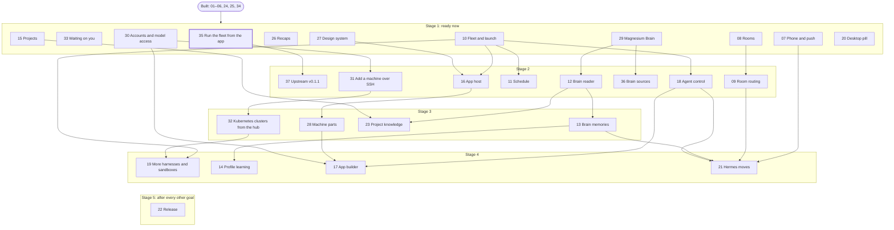

# Magnesium tracker

The one place for the order goals are built in and where each one stands. Each goal's file in [`docs/magnesium/goals/`](docs/magnesium/goals/) holds its build, tests, summary and next steps.

- **Order** is the build order. It changes only when the owner reorders.
- **Status** is `Planned`, `In progress`, `Verified` or `Blocked`, with the reason when blocked.
- Change a goal's row in the same commit that changes its status.

| Goal                                                                   | Order | Description                                                                                                                                                                                                                                                                  | Status      |
| ---------------------------------------------------------------------- | ----- | ---------------------------------------------------------------------------------------------------------------------------------------------------------------------------------------------------------------------------------------------------------------------------- | ----------- |
| [01](docs/magnesium/goals/_completed/01-fork-and-rebrand.goal)         | 1     | **Fork and rebrand.** T3 Code runs as Magnesium, with telemetry and self-update off.                                                                                                                                                                                         | Verified    |
| [02](docs/magnesium/goals/_completed/02-deploy-hub-and-machines.goal)  | 2     | **Deploy the hub and machines.** One URL on desktop and phone reaches every server through the hub.                                                                                                                                                                          | Verified    |
| [03](docs/magnesium/goals/_completed/03-profiles-and-sandboxes.goal)   | 3     | **Profiles and sandboxes.** Pick a profile and sandbox for any thread, on any machine. Agents run fenced by default, and the hub delivers profiles to the machines.                                                                                                          | Verified    |
| [04](docs/magnesium/goals/_completed/04-hub-link.goal)                 | 4     | **Hub link.** The hub shows every server live in Fleet; devices reach machines only through the hub.                                                                                                                                                                         | Verified    |
| [05](docs/magnesium/goals/_completed/05-shell-sidebar-and-footer.goal) | 5     | **Shell, sidebar and footer.** Places, project folders and the footer status bar; installs as a desktop app.                                                                                                                                                                 | Verified    |
| [06](docs/magnesium/goals/_completed/06-home-needs-you.goal)           | 6     | **Home: needs you.** Every approval, question and plan from every machine shows on Home and is answered there.                                                                                                                                                               | Verified    |
| [25](docs/magnesium/goals/_completed/25-spokes-on-kubernetes.goal)     | 7     | **Spokes in Kubernetes.** Machine servers run in their own pods or attached inside workloads' pods, and join and pair with the hub by themselves.                                                                                                                            | Verified    |
| [24](docs/magnesium/goals/_completed/24-upstream-v2.goal)              | 8     | **Upstream V2.** Upstream's v0.1.0 with Orchestrator V2 on every server; scheduled runs show on Home.                                                                                                                                                                        | Verified    |
| [34](docs/magnesium/goals/_completed/34-profiles-in-the-app.goal)      | 9     | **Profiles in the app.** Create, edit and delete profiles in the app: instructions, skills, MCP tools, environment, machines and knowledge access. See which machines hold each version, approve the changes agents ask for, and chat with each profile on the hub as a bot. | Verified    |
| [35](docs/magnesium/goals/35-run-the-fleet-from-the-app.goal)          | 10    | **Run the fleet from the app.** Update, roll back and back up any server from Fleet, the hub included; add, forget and edit machines and pods; see each server's backups and time zone, with Restore.                                                                        | In progress |
| [37](docs/magnesium/goals/37-upstream-v0-1-1.goal)                     | 11    | **Upstream v0.1.1.** Upstream's newest stable release (1,486 commits: speed, Run on a project to another machine, webhook filters, `t3 doctor`, LaTeX) merged, and rolled to every server with Fleet.                                                                        | Planned     |
| [33](docs/magnesium/goals/33-waiting-on-you.goal)                      | 12    | **Waiting on you.** A turn that ends asking you something, or waiting on your approval, shows on Home's Needs you, checked by a cheap model.                                                                                                                                 | Planned     |
| [15](docs/magnesium/goals/15-projects.goal)                            | 13    | **Projects.** One project across machines; its page shows what needs you and every thread.                                                                                                                                                                                   | Planned     |
| [30](docs/magnesium/goals/30-provider-accounts.goal)                   | 14    | **Accounts and model access.** Sign in to Claude Code and Codex once on the hub, and add, test and rotate model keys and gateways with their model lists. Every machine gets them, you swap the active account from the hub, and usage is recorded per profile.              | Planned     |
| [31](docs/magnesium/goals/31-add-a-machine-over-ssh.goal)              | 15    | **Add a machine over SSH.** Give the hub an SSH target and it installs, starts, pairs and ships your accounts, in a pod too.                                                                                                                                                 | Planned     |
| [32](docs/magnesium/goals/32-kubernetes-clusters-from-the-hub.goal)    | 16    | **Kubernetes clusters from the hub.** Give the hub a namespace: it deploys the gateway, runs Magnesium's own pods and attaches to a workload you pick.                                                                                                                       | Planned     |
| [26](docs/magnesium/goals/26-recaps.goal)                              | 17    | **Recaps.** A long-running session says what it did, what is open for you and what it is doing now, with a model you pick.                                                                                                                                                   | Planned     |
| [07](docs/magnesium/goals/07-phone-and-push.goal)                      | 18    | **Phone and push.** Installed on the phone; a locked phone gets "1 needs you" and you approve from it.                                                                                                                                                                       | Planned     |
| [08](docs/magnesium/goals/08-rooms.goal)                               | 19    | **Rooms.** You and several bots in one room, with explicit routing, hop caps and Stop.                                                                                                                                                                                       | Planned     |
| [09](docs/magnesium/goals/09-room-routing.goal)                        | 20    | **Room routing.** A router picks who an unaddressed message is for, in shadow mode first, then live.                                                                                                                                                                         | Planned     |
| [10](docs/magnesium/goals/10-fleet-and-launch.goal)                    | 21    | **Fleet and launch.** Live load and GPUs per machine, what runs where, and launch anywhere.                                                                                                                                                                                  | Planned     |
| [11](docs/magnesium/goals/11-schedule.goal)                            | 22    | **Schedule.** Create and edit scheduled runs, with history and a failure inbox.                                                                                                                                                                                              | Planned     |
| [18](docs/magnesium/goals/18-agent-control.goal)                       | 23    | **Agent control.** A profile launches and steers a worker on another machine, within your grants.                                                                                                                                                                            | Planned     |
| [19](docs/magnesium/goals/19-more-harnesses-and-sandboxes.goal)        | 24    | **More harnesses and sandboxes.** OpenCode, Pi and oh-my-pi profiles; Kubernetes and microVM sandboxes.                                                                                                                                                                      | Planned     |
| [29](docs/magnesium/goals/29-magnesium-brain.goal)                     | 25    | **Magnesium Brain.** Magnesium runs its own knowledge base; agents reach it only through Magnesium, and an existing one can be imported once.                                                                                                                                | Planned     |
| [36](docs/magnesium/goals/36-brain-sources.goal)                       | 26    | **Brain sources.** Add, sync, pause, fix and remove what feeds the Brain, move the old knowledge base's collectors in, and say why each new item matters.                                                                                                                    | Planned     |
| [12](docs/magnesium/goals/12-brain-reader.goal)                        | 27    | **Brain reader.** Ask the Brain, browse it as a tree, read any page and start a thread about it.                                                                                                                                                                             | Planned     |
| [13](docs/magnesium/goals/13-brain-memories.goal)                      | 28    | **Brain memories.** Edit a memory, ask its owner to change one, and retry the dream cycle.                                                                                                                                                                                   | Planned     |
| [14](docs/magnesium/goals/14-profile-learning.goal)                    | 29    | **Profile learning.** A profile's sessions turn into its own memory notes and skill proposals.                                                                                                                                                                               | Planned     |
| [23](docs/magnesium/goals/23-project-knowledge.goal)                   | 30    | **Project knowledge.** Drop a doc on a project; it lands in the Brain, linked to the project's threads.                                                                                                                                                                      | Planned     |
| [27](docs/magnesium/goals/27-design-system.goal)                       | 31    | **Design system.** Apps built only from Magnesium's kit look native and follow your theme; agents build with it.                                                                                                                                                             | Planned     |
| [16](docs/magnesium/goals/16-app-host.goal)                            | 32    | **App host.** An app gets a page, a footer item, a popover and actions that ask first.                                                                                                                                                                                       | Planned     |
| [28](docs/magnesium/goals/28-machine-parts.goal)                       | 33    | **Machine parts.** An app with a part on chosen machines: stats for its hub page, tools for sessions there.                                                                                                                                                                  | Planned     |
| [17](docs/magnesium/goals/17-app-builder.goal)                         | 34    | **App builder.** A builder thread on the hub builds and publishes apps and plugins with you, coordinating agents on other machines.                                                                                                                                          | Planned     |
| [20](docs/magnesium/goals/20-desktop-pill.goal)                        | 35    | **Desktop pill.** A small desktop pill shows who needs you and approves in one click.                                                                                                                                                                                        | Planned     |
| [21](docs/magnesium/goals/21-hermes-moves.goal)                        | 36    | **Hermes moves.** Bots import from Hermes Agent one at a time, with a trial window, until Hermes can be retired.                                                                                                                                                             | Planned     |
| [22](docs/magnesium/goals/22-release.goal)                             | 37    | **Release.** A day of daily use, and upgrade, rollback and restore drills pass.                                                                                                                                                                                              | Planned     |

## What runs in parallel

Drawn from each goal's `depends_on`. Goals in the same stage don't depend on each other and can run side by side; an arrow means the lower goal waits for the upper one. **Order** in the table above picks which ready goal goes first. Redraw this when a goal's `depends_on` changes or a goal is verified.

| Stage | These can run side by side                                                                                                                                                                                      | Each one waits on                                                          |
| ----- | --------------------------------------------------------------------------------------------------------------------------------------------------------------------------------------------------------------- | -------------------------------------------------------------------------- |
| 1     | 35 Run the fleet from the app, 33 Waiting on you, 15 Projects, 30 Accounts and model access, 26 Recaps, 07 Phone and push, 08 Rooms, 10 Fleet and launch, 29 Magnesium Brain, 27 Design system, 20 Desktop pill | Only what's built                                                          |
| 2     | 37 Upstream v0.1.1, 31 Add a machine over SSH, 09 Room routing, 11 Schedule, 18 Agent control, 36 Brain sources, 12 Brain reader, 16 App host                                                                   | 37 ← 35; 31 ← 30; 09 ← 08; 11 ← 10; 18 ← 10; 36 ← 29; 12 ← 29; 16 ← 10, 27 |
| 3     | 32 Kubernetes clusters from the hub, 13 Brain memories, 23 Project knowledge, 28 Machine parts                                                                                                                  | 32 ← 31; 13 ← 12; 23 ← 12, 15; 28 ← 16                                     |
| 4     | 19 More harnesses and sandboxes, 14 Profile learning, 17 App builder, 21 Hermes moves                                                                                                                           | 19 ← 10, 32; 14 ← 13; 17 ← 18, 28, 30; 21 ← 07, 09, 13, 18                 |
| 5     | 22 Release                                                                                                                                                                                                      | Every other goal                                                           |

The longest serial chains, each four goals before Release:

- 30 Accounts → 31 Add over SSH → 32 Clusters → 19 Harnesses and sandboxes
- 29 Magnesium Brain → 12 Brain reader → 13 Brain memories → 14 Profile learning, or → 21 Hermes moves
- 10 Fleet and 27 Design system → 16 App host → 28 Machine parts → 17 App builder
