# Magnesium mockups

These are the 18 boards of the owner's mock canvas (D9), in their default state and light theme. The canvas lives in the repo, in [`mockups/canvas/`](mockups/canvas/): one `.dc.html` file per board, laid out by `canvas.json`. Run `vp run mocks` and open the printed address to click through every board, in light or dark; `vp run mocks:render` writes the images on this page from it. They are **the UX target** for the build: each goal says which boards it makes real, and a goal is checked against its boards before it is done ([goals](goals/README.md), "Done means" 2).

**The boards are the target, not the code.** Components are built in the fork, on T3 Code's tokens ([doc 07](07-t3code-ux.md)), and compared with these images. Every number, name, machine, bot and project on the boards is invented **example data**.

**What's built today:** the sidebar of Home and Session, and the footer's core items (goal 05). The rest of each board comes with the goals in the table below; each built part has a dated note under its board.

| Board                                            | Goals that make it real                                                     | Phase |
| ------------------------------------------------ | --------------------------------------------------------------------------- | ----- |
| [Home · desktop](#home--desktop)                 | 05 (sidebar), 06 (needs you), 10 (fleet tiles)                              | 2     |
| [Session · desktop](#session--desktop)           | 03 and 19 (profile and sandbox picker), 05 (sidebar)                        | 1     |
| [Room · desktop](#room--desktop)                 | 08 (rooms), 09 (routing and decision log)                                   | 3     |
| [Brain · desktop](#brain--desktop)               | 12 (reader), 13 (memories, dream cycle), 14 (skills)                        | 5     |
| [Brain · document open](#brain--document-open)   | 12                                                                          | 5     |
| [Project · desktop](#project--desktop)           | 15                                                                          | 5     |
| [Profiles · desktop](#profiles--desktop)         | 34                                                                          | 2     |
| [Fleet · desktop](#fleet--desktop)               | 04 (first list), 10 (fleet and launch), 18 (started by), 35 (run the fleet) | 4     |
| [Apps · desktop](#apps--desktop)                 | 16 (app host), 17 (New app)                                                 | 6     |
| [Selected app · desktop](#selected-app--desktop) | 16                                                                          | 6     |
| [Home · phone](#home--phone)                     | 07                                                                          | 7     |
| [Session · phone](#session--phone)               | 07                                                                          | 7     |
| [Room · phone](#room--phone)                     | 08                                                                          | 7     |
| [Fleet · phone](#fleet--phone)                   | 10, 35                                                                      | 7     |
| [Profiles · phone](#profiles--phone)             | 34                                                                          | 2     |
| [App · phone](#app--phone)                       | 16                                                                          | 7     |
| [Footer](#footer)                                | 05 (core items), 16 (app items)                                             | 2, 6  |
| [Footer · popover open](#footer--popover-open)   | 16                                                                          | 6     |

Not mocked yet: **Schedule** (goal 11 mocks it) and the **desktop pill** (goal 20 mocks it). What it takes to build each screen, piece by piece, is in [doc 13](13-mocks-to-working-app.md).

## Desktop

### Home · desktop

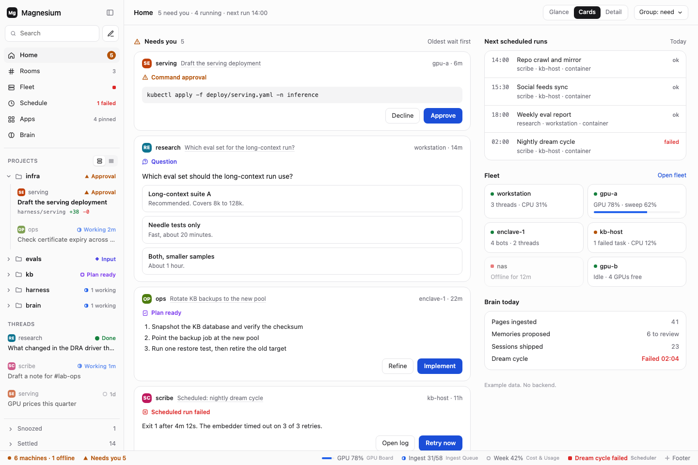

**What it shows**

- **The sidebar shell:** places (Home, Rooms, Fleet, Schedule, Apps, Brain), project folders with a status roll-up, standalone threads, settled and snoozed, and a comfy and compact switch.
- **"Needs you" cards answered in place:** a command approval, a question with options, a plan ready to implement, a failed scheduled run.
- **The zoom levels:** Glance, Cards and Detail. Detail loads tool output on demand.
- **Beside the feed:** next scheduled runs, fleet tiles, and Brain today.
- **The footer** at the bottom, on every page.

**Built in:** goal 05 (sidebar and footer), goal 06 (the feed), goal 10 (fleet tiles). The feed gathers from every machine through the hub (D15). It ranks by kind first, then oldest wait, with a pin to override (D18).

**Changed since the mock:** "Memories proposed · 6 to review" in Brain today becomes recent memories. There is no review gate (D22).

**2026-10-15, goal 05 (the sidebar and the footer; the feed is goal 06):** built and compared on the hub. Differences from the board:

- Places shows only Fleet; Home, Rooms, Schedule, Apps and Brain appear when their goals land.
- The search row keeps upstream's open-folder, new-project and new-thread buttons beside Search.
- Comfy rows are upstream's thread cards: the project's chip and name, the title and the branch. The board's profile chip and name aren't on the card.
- Pinned threads, an upstream feature, sit above Projects.
- "All N threads" scopes the list to the project until goal 15's project page; scoped, it reads "All projects".
- Two folders with the same name each show their machines after the name.
- Monitoring (a dashed ring) and idle (a ring) are shapes the board doesn't have.

**2026-10-16, goal 06 (the feed):** built and compared on the hub, in light and dark. Differences from the board:

- The header has no next run (goal 24) and no "Group: need" menu; Home has one order, D18's.
- A card's header names the project and the thread, not the profile's chip and name, and every card has a pin.
- Approval buttons are the provider's own choices, such as "Allow once", "Allow for workspace" and "Deny", with the plain approve last and filled.
- A question the provider lets you answer in words also has "Or type an answer" and Answer.
- Refine on a plan opens the thread.
- Failures are failed threads, with Settle and Open thread. Failed scheduled runs, with Open log and Retry now, come with goal 24.
- Beside the feed is Running now. Next scheduled runs (goal 24), fleet tiles (goal 10) and Brain today (goal 12) are still to come.
- "Needs you" has no warning sign, and Home's count in the sidebar is a soft amber pill, not a solid one.

**2026-10-18, goal 24 (scheduled runs, on V2):** built and compared on the hub. Differences from the board:

- Next scheduled runs names each task's project and machine, not its sandbox, and has no "Today" label: a run on another day shows its day.
- A scheduled run that started and failed is its thread's failure, labelled "Scheduled run failed", with Settle, Open thread and Retry now. Open thread stands in for Open log.
- A run that never started (no thread was made) has Open task and Retry now.
- The header shows the next run as on the board; Group: need is still not there.

### Session · desktop

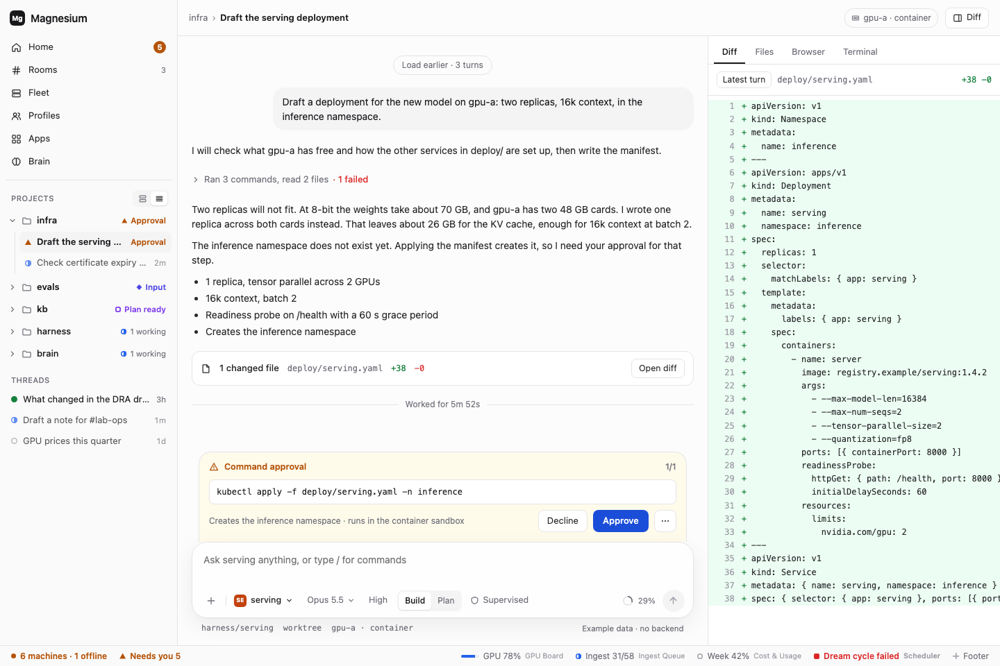

**What it shows**

- **T3 Code's thread view as it is:** a collapsed tool group, the docked command approval, the diff panel, steer and stop.
- **In the composer:** the profile picker (`serving`), model, effort, Build or Plan, and the supervised mode.
- **In the header and footer:** the machine and sandbox chip (`gpu-a · container`) and the worktree.

**Built in:** most of it is stock T3 Code. Goal 03 adds profiles and sandboxes, with supervised as the default. Goal 19 adds more harnesses and sandbox kinds.

**2026-10-15, goal 05 (the compact sidebar):** built and compared on the hub. Compact rows lead with their status shape and name Approval, Input or Failed in place of their time, as on the board. A plan-ready thread shows the idle shape: its row has no plan state, though its folder's roll-up says Plan ready.

### Room · desktop

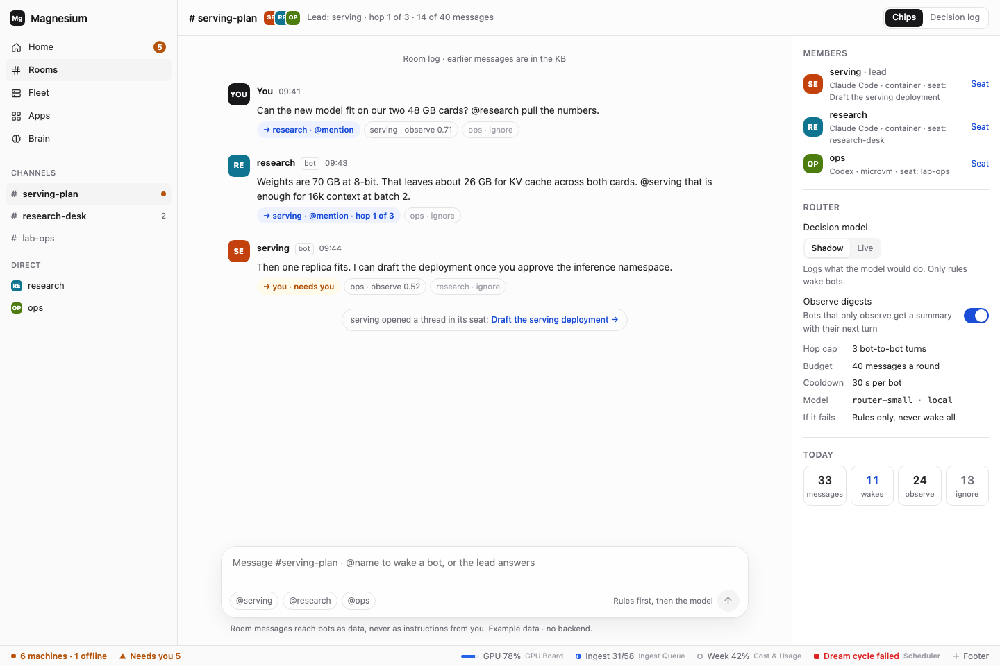

**What it shows**

- **A channel** with three bots.
- **Routing chips** on every message: who was woken, and why.
- **The router panel:**
  - the decision model, in shadow or live mode;
  - digests for bots that only observe;
  - the hop cap, budget and cooldown;
  - what happens when the router fails.
- **Each member's seat:** an ordinary thread, linked from the room.

**Built in:** goal 08 (rooms with explicit `@` routing, hop caps and Stop) and goal 09 (Clef picks who an unaddressed message is for, shadow first). The design is in [doc 12](12-channel-chat-and-events.md).

**Related, not mocked:** agents in any thread can message another session by its fully qualified name, `@machine.harness.id` (D32, goal 18).

### Brain · desktop

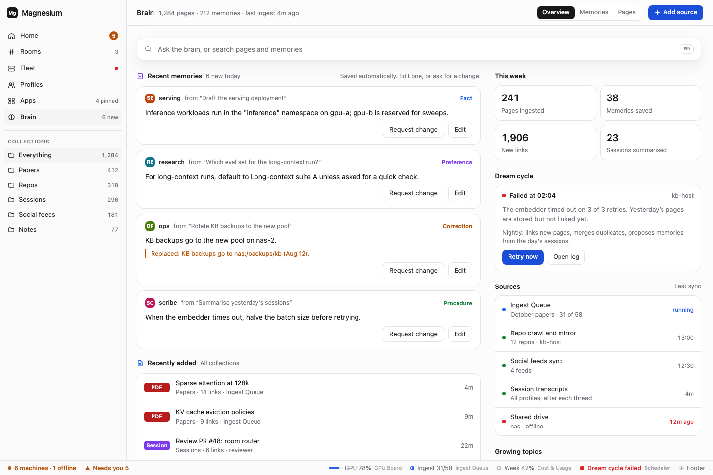

**What it shows**

- **Ask the brain.**
- **Recent memories:** saved automatically, with Edit and Request change on each.
- **Recently added.**
- **This week's numbers.**
- **The dream cycle**, with retry.
- **Sources and when each last synced.**
- **Collections** in the sidebar.

**Built in:** goal 12 (reader and ask), goal 13 (memory edits and change requests, dream cycle retry), goal 14 (skills learned from sessions). It reads the KB through GBrain's MCP tools.

### Brain · document open

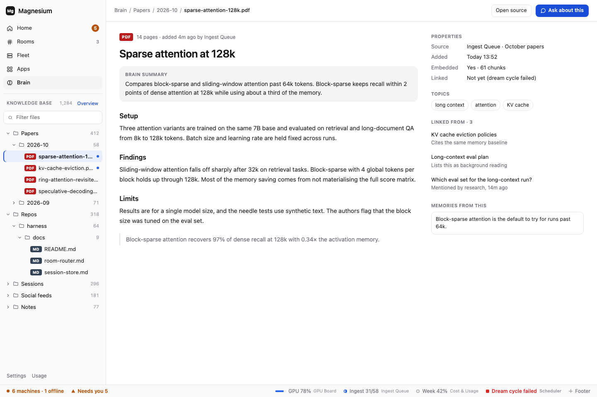

**What it shows**

- **The KB as a file tree** in the sidebar.
- **One page open**, with the brain's summary, its properties, topics, backlinks and the memories that came from it.
- **"Ask about this"**, which starts a thread with the page as context.

**Built in:** goal 12.

### Project · desktop

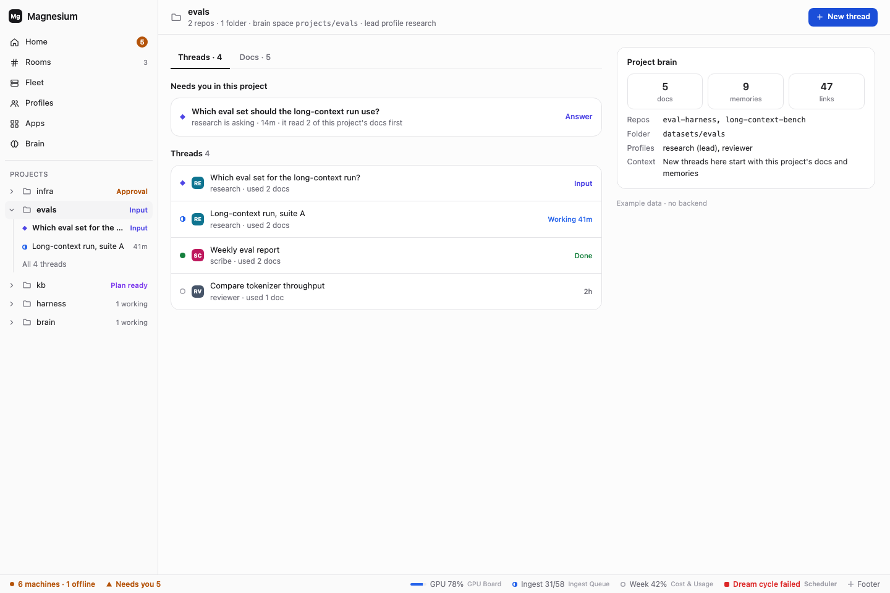

**What it shows**

- **A project's threads and docs together.**
- **What needs you in this project.**
- **The project brain:** docs, memories, links, repos, folder and profiles.
- **Context:** new threads here start with the project's docs.

**Built in:** goal 15 (the project across machines, its threads and what needs you in it), right after Home; goal 23 (its docs and project brain). Project docs live in the brain, tied to the project (D23).

### Profiles · desktop

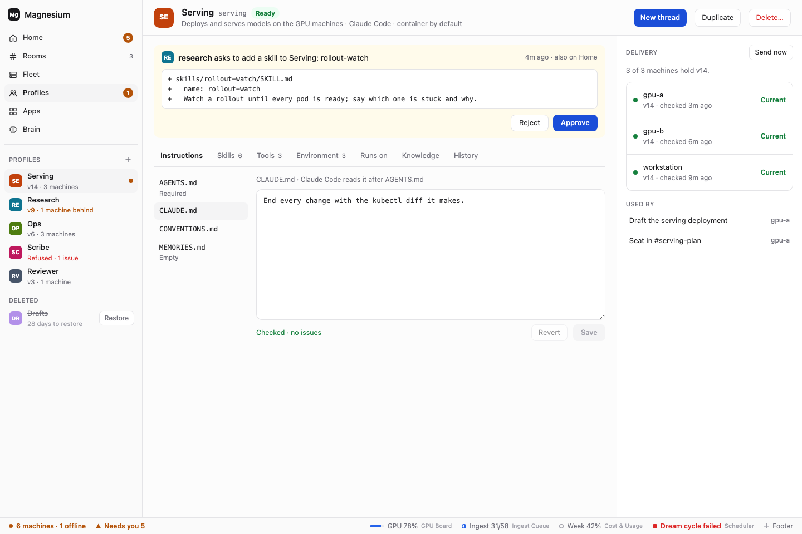

**What it shows**

- **Profiles is a place,** listed under the places like Fleet's machines, each with its version and anything wrong: a refused profile, a machine behind, an agent asking for a change.
- **An agent's change waits for you:** research asks to add a skill to Serving; the diff, with Reject and Approve, here and on Home.
- **Every part of a profile in tabs:** its instructions files, with Add a file, in an editor that checks on save; skills; MCP servers, Magnesium's own among them, each tool Allowed, Asking first or Off; environment variable names set or missing on each machine; where it runs, every machine by default or the ones you tick, with its harnesses, default sandbox and launch arguments; what it may read and write in the Brain; and history with Put back.
- **Delivery:** which version each machine holds, with Send now, and the threads that use the profile.
- **New, Duplicate and Delete,** and Deleted profiles restored within 30 days.

**Built in:** goal 34 (D65). The Knowledge tab's access is edited here once the Brain exists (goal 29).

**How it's read (D68):** the profiles listed under the sidebar's places are bots: clicking one opens your conversation with it on the hub, with New conversation beside it. The Profiles place opens the phone board's list at every width, and a profile opens as this board shows it, at full width.

### Fleet · desktop

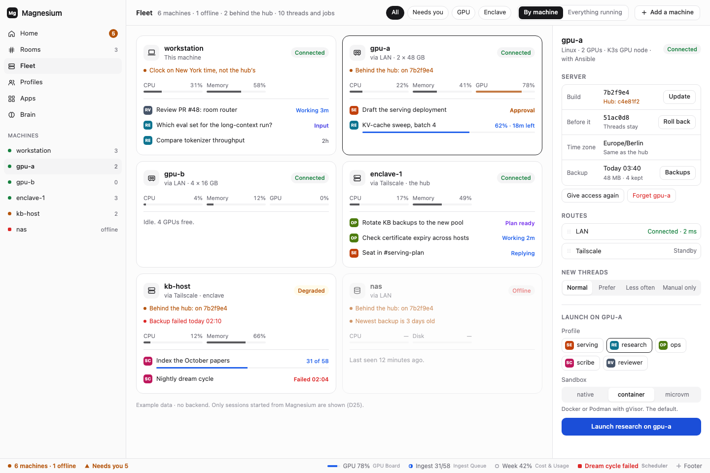

**What it shows**

- **Every machine** with CPU, memory and GPU load, and what runs on it.
- **Routes** (LAN, Tailscale) and the load-balancing preference for new threads.
- **Launch** on a machine with a profile and a sandbox (native, container, microVM).
- **Each server's build, time zone and backups,** under Server in its panel. A card says when the server is behind the hub, its backup failed or is more than two days old, or its clock isn't on the hub's time zone.
- **Running the fleet:** Update to the hub's build, Roll back to the build before, Backups with Back up now and Restore…, Edit pod for a Magnesium pod, Give access again and Forget. Each asks first and says what restarts; progress and the result show in the panel. **Add a machine** takes its address and a pairing code.

**Built in:** goal 04 (the hub's first live list), goal 10 (metrics, jobs and launch), goal 18 ("started by" when an agent launched it), goal 35 (update, roll back, backups, add and forget machines, edit pods, time zones). Each Magnesium server collects its own metrics (D21).

**Rules:** only sessions started from Magnesium are shown (D25). GPUs on the GPU hosts are read-only to Magnesium: it shows their metrics and starts no GPU work there.

### Apps · desktop

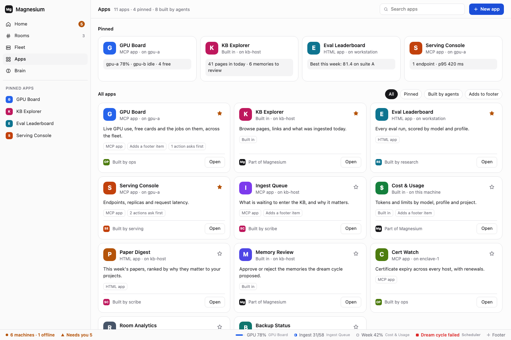

**What it shows**

- **Pinned apps**, then every app with filters (pinned, built by agents, adds to footer).
- **On each card:** its kind (MCP, HTML or built in), where it is served, who built it, and whether its actions ask first.
- **"New app",** which starts an agent that builds one.

**Built in:** goal 16 (the app host and registry) and goal 17 (the app builder). Apps live only on the hub (D24). The extension model is in [doc 14](14-apps-and-footer-extension-model.md).

**Changed since the mock:** the "Memory Review" app ("approve or reject the memories the dream cycle proposed") predates D22. Memories are saved automatically and edited from Brain, so that app goes.

### Selected app · desktop

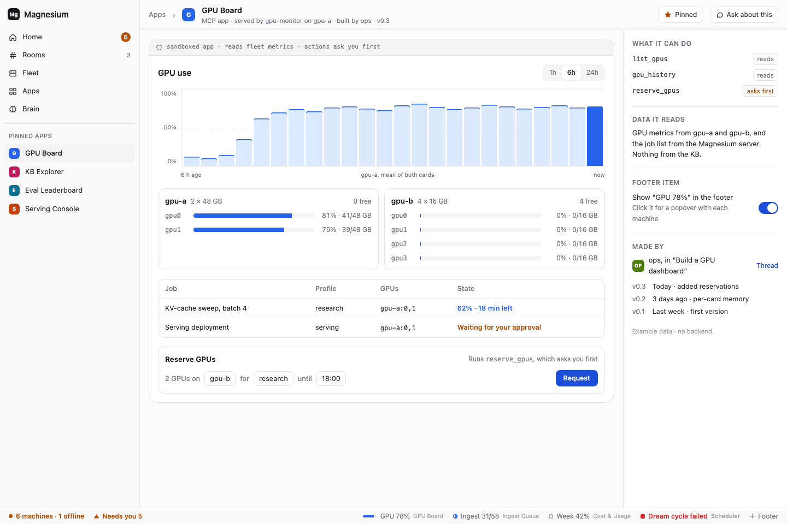

**What it shows**

- **GPU Board**, a sandboxed app: a usage chart, each GPU, and the jobs on them.
- **A "Reserve GPUs" action** that asks you first.
- **Beside it:**
  - its tools and whether each one reads or asks first;
  - what data it reads;
  - its footer item;
  - who made it, with versions.

**Built in:** goal 16. App actions go through approvals that also show on Home.

## Phone

The same web UI, installed as an app on the phone (D10). Goal 07 adds web push, so a locked phone gets "1 needs you" (D16).

### Home · phone

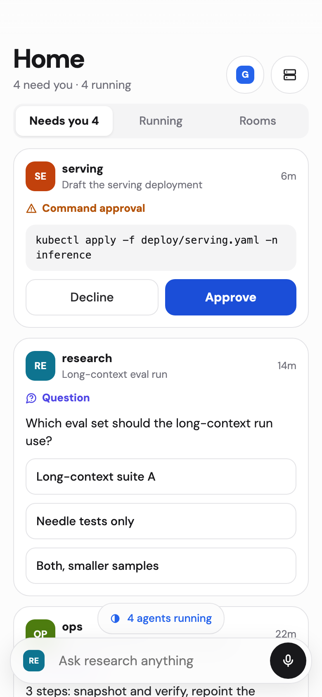

**What it shows:** "Needs you", Running and Rooms tabs, cards you can answer with one thumb, a running-agents pill, and a composer for the current profile. **Built in:** goal 07.

### Session · phone

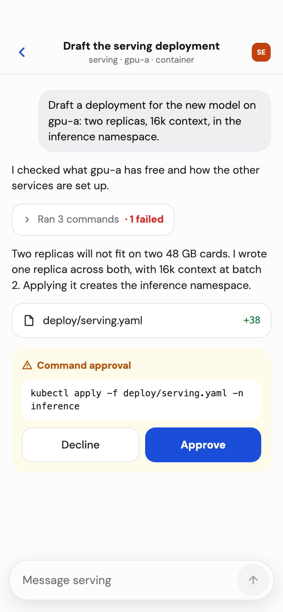

**What it shows:** a thread with collapsed tool calls, a file change, and the approval card. Steer or stop from the composer. **Built in:** goal 07.

### Room · phone

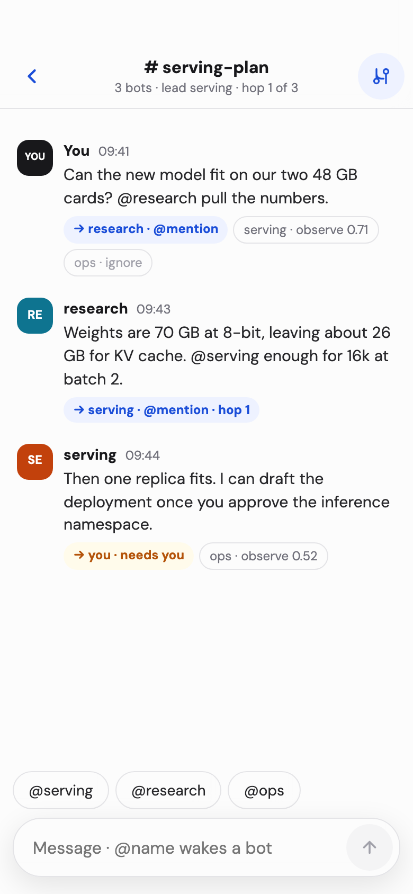

**What it shows:** the room log with routing chips (which can be hidden), `@` buttons to wake a bot, and the hop count in the header. **Built in:** goal 08.

### Fleet · phone

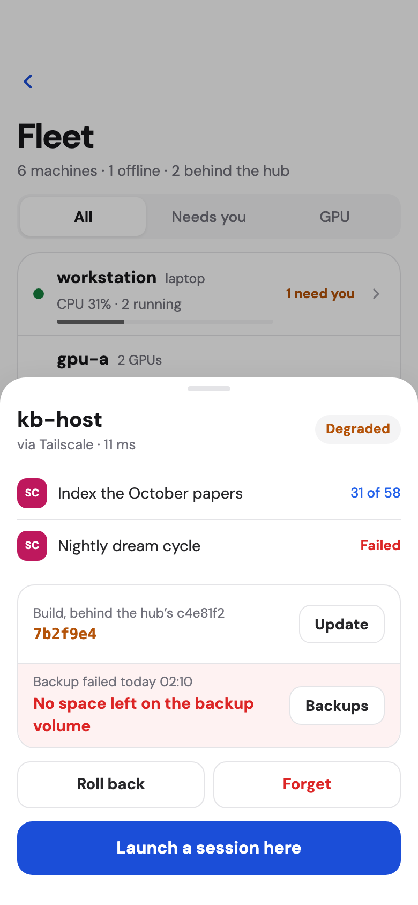

**What it shows:** each machine's load and what needs you there, with All, Needs you and GPU filters. A row says when its backup failed or it's behind the hub. A machine's sheet shows its build and newest backup, with Update, Backups (Back up now, Restore…), Roll back and Forget, each confirmed in the sheet. **Built in:** goal 10, goal 35.

### Profiles · phone

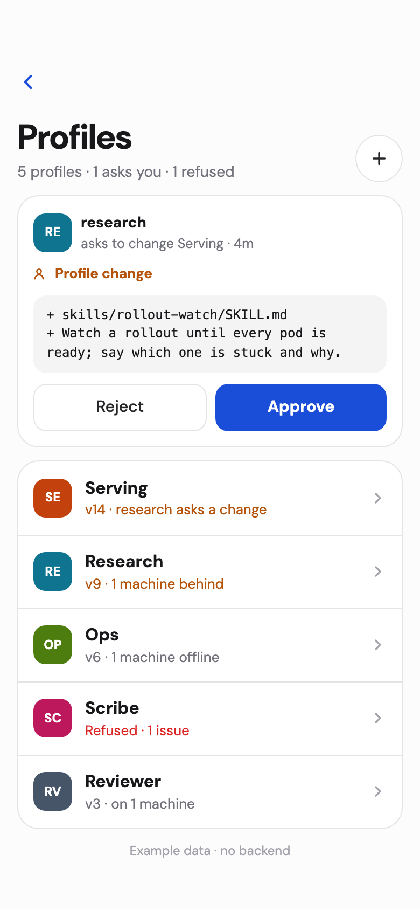

**What it shows:** the profiles with what needs a look, and an agent's change to approve with one thumb. A profile opens its sections and which version each machine holds, with Send now. **Built in:** goal 34.

### App · phone

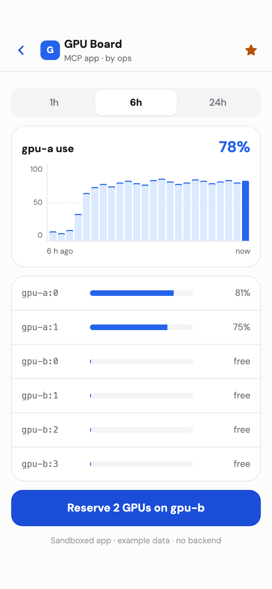

**What it shows:** GPU Board at phone size, with a time range, each GPU, and the reserve action. **Built in:** goal 16.

## Footer

### Footer

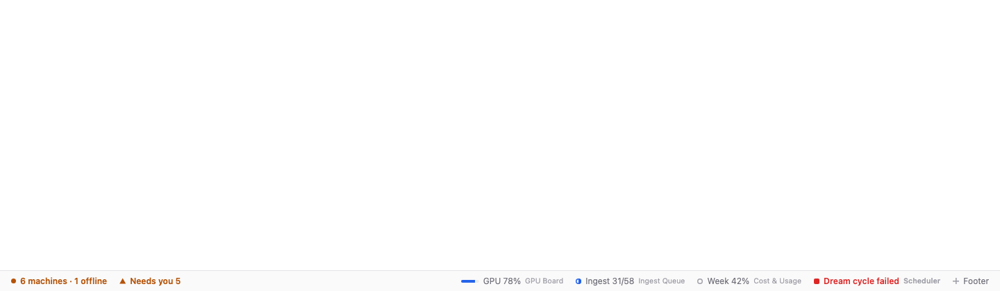

**What it shows**

- **The status bar on every page.**
- **Core items on the left:** machines and offline count, and "Needs you".
- **Items that apps add on the right:** GPU, ingest, cost, and the scheduler's failure.
- **"+ Footer",** to choose which items show.

**Built in:** goal 05 (the slot and core items), goal 16 (app items).

**2026-10-15, goal 05:** the core items and "+ Footer" are built and compared on the hub. Differences: no app items until goal 16; the core items' popovers follow the GPU popover's layout; while the hub can't be reached, the bar says Offline instead of numbers; "Needs you" counts approvals and questions, and goal 06 adds plans and failed runs.

### Footer · popover open

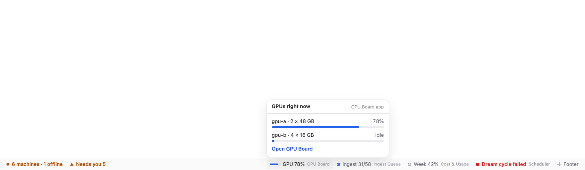

**What it shows:** clicking an app's footer item opens its popover. Here, GPU Board shows each machine's GPUs and links to the app. **Built in:** goal 16.

## Keeping this page current

- **When a goal makes a board real,** add a line under that board: the date, and how the built screen differs from the mock. The goal's summary has the screenshots and the full list of differences.
- **When the canvas changes,** edit its board files in `mockups/canvas/`, run `vp run mocks:render` for the boards you changed, and commit both. A new board gets an entry in `canvas.json`, with the image name under `png`. A redesign moves the canvas, not this page.
